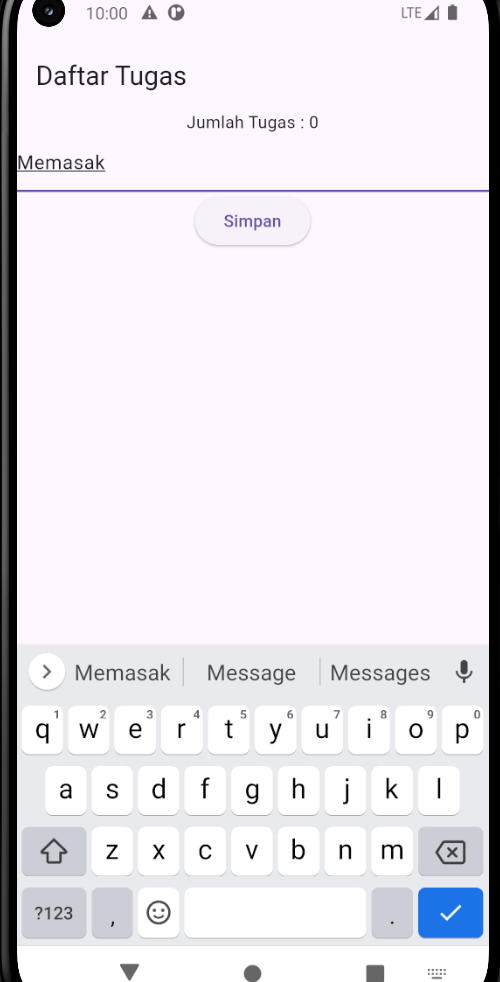
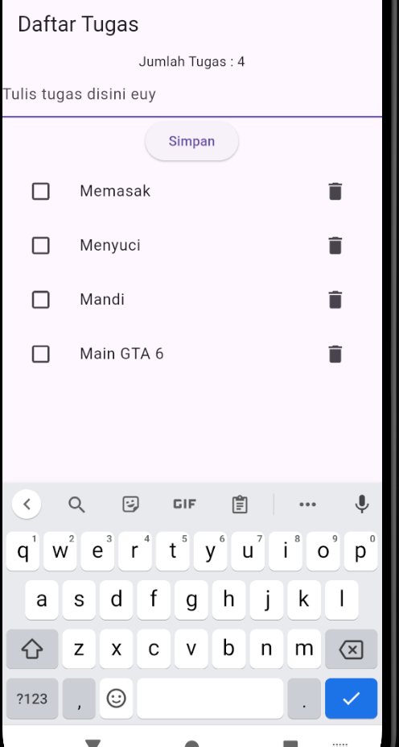
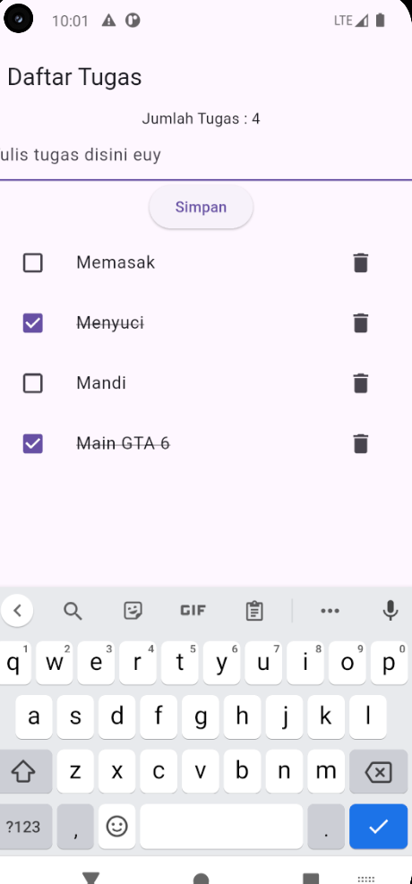
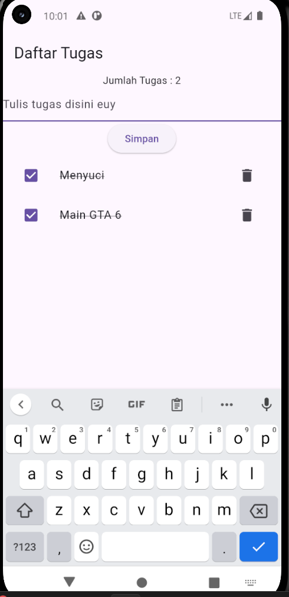

# Mini Task Tracker

Aplikasi mobile Flutter sederhana untuk mencatat daftar tugas harian.

## Identitas
- Nama: Keanu Fibie Dimasyqi
- NIM: 103012430045

## Fitur
- Menambah tugas lewat kolom input dan tombol Simpan
- Menampilkan daftar tugas beserta jumlahnya
- Menandai tugas selesai (teks tugas dicoret)
- Menghapus tugas dari daftar
- Peringatan (SnackBar) jika input kosong

Data disimpan di state aplikasi menggunakan `setState`, tanpa database.

## Screenshot

| Tampilan Awal | Input Tugas | Daftar Tugas |
|---|---|---|
|  |  |  |

| Tandai Selesai | Hapus Tugas |
|---|---|
|  |  |

## Cara Menjalankan

### Install APK
Unduh file `app-release.apk` dari folder Google Drive pengumpulan, lalu install di perangkat Android.

### Dari Source Code
1. Pastikan Flutter SDK sudah terpasang (cek dengan `flutter doctor`)
2. Clone repositori ini:
   ```
   git clone https://github.com/oXkenXo/mini-task-tracker.git
   cd mini-task-tracker
   ```
3. Install dependency:
   ```
   flutter pub get
   ```
4. Jalankan di emulator atau perangkat Android:
   ```
   flutter run
   ```

### Deklarasi Penggunaan AI
- Apakah menggunakan AI? Ya
- Tool AI yang digunakan: Claude
- Estimasi persentase kontribusi AI: 20%
- Bagian kode/fitur yang dibantu AI:
  - Referensi dan penjelasan konsep dasar Flutter (StatefulWidget, setState, ListView.builder, Checkbox)
  - Troubleshooting instalasi Flutter dan Android SDK, serta error saat build APK (konfigurasi versi NDK)
  - Debugging kesalahan sintaks
  - Penyusunan struktur README.md
- Pernyataan:
  "Saya menyatakan bahwa saya memahami alur dan fungsi dari seluruh kode yang ada dalam repositori ini"
